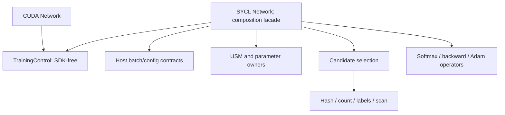

# G-SLIDE component library: scope and first decomposition

The goal of this change is to make existing behavior independently testable
before expanding the SYCL model. It adds no hidden layers, checkpoint format,
new CUDA dispatch policy or performance acceptance. The incoming revision is
`3e8186677b8a7ff439c67017ee1a36de36259480`; its numerical checkpoints remain
historical evidence, distinct from the new component tests.

## Named API follow-up

The accepted design is now implemented by `configuration.hpp`, `views.hpp`,
`component_api.hpp` and `storage.hpp`; see [semantic decisions and source
review](GSLIDE_SEMANTICS.md). Configuration and necessary workspace capacities
are checked before allocation; typed operations distinguish logical matrix
shape, layout, used IDs and asserted allocation capacity. Model/optimizer,
index and workspace ownership are separate groups. Network retains a queue
copy and composes these operations; the old positional constructor and pointer
evaluation overload remain compatibility adapters. Four host suites and eleven
device/integration suites are enrolled. General strides and an asynchronous API
remain outside the current contract.

## What “all functionality” had conflated

There was no agreed complete feature inventory behind that phrase. Four
different questions must be tracked separately:

| Category | Concrete examples | Meaning for this change |
| --- | --- | --- |
| Existing model/API differences | CUDA has a vector of hidden ReLU layers; SYCL's numerical facade has one hidden layer. Native entrypoint reads JSON/data and computes evaluation counts; SYCL accepts validated batches and returns dense logits. | Explicit scope differences; do not expand them during decomposition. |
| Backend implementations and choices | CUDA shared-memory/fallback Softmax/backward kernels, cuBLAS and Thrust; SYCL reference dense product, quadratic scan/sort and direct-address candidate frequencies. | Different implementations/strategies, not automatically missing mathematical features. Preserve and name their contracts. |
| Validation gaps | Broader extents/K/bin combinations, contention/overflow stress, caller queue/stream variants, CUDA/SYCL same-input comparisons, quality and performance. | Unverified conditions, not evidence of an absent feature. Performance is an acceptance measurement, not a model feature. |
| Possible future product features | Model checkpoint persistence and restore. | No checkpoint API was found in the current native Network/Layer/main interfaces. This is a future feature proposal, not an established missing SYCL counterpart. |

Two semantic differences were identified before claiming model
parity: SYCL dense evaluation includes output bias whereas the native cuBLAS
caller omits it, and the maintained hash code preserves the released natural-log
packing variant. The [primary-source review](GSLIDE_SEMANTICS.md) now records the decisions.
The API refactor preserves these documented behaviors.

## Existing decomposition at the incoming revision

The CUDA source already had `Network`, `Layer`/`ReluLayer`/`SoftmaxLayer`, `LSH`,
`GPUMultiLinkedHashTable` and `CscActNodes`. Those classes provide useful coarse
responsibilities, but allocation, CUDA handles, compressed representations,
launch choice and numerical operations remain coupled. Constructing a class is
not a small SDK-free unit test. Existing extracted-body/mock tests and actual
CUDA execution remain separate evidence.

`include/TrainingControl.h::train_step` was already a good independent seam:
it owns only operation order and callbacks and is shared by CUDA and SYCL.
The portable `kernels.hpp` already exposed queue/USM functions. The remaining
SYCL `network.hpp` was 475 lines and combined allocation, parameter state,
batch validation/transfer, index query/materialization, Softmax/backward, Adam
and orchestration. Its device tests were two CTest executables, including
several logically independent checks inside the connected test.

## Boundaries introduced now

| Public component | Contract and responsibility | Independently tested |
| --- | --- | --- |
| `TrainingControl.h` | Common callback order; no runtime or numerical implementation. | Zero/two hidden callbacks, rebuild/reshuffle combinations; ordinary C++ only. |
| `contracts.hpp`, `batch.hpp` | Sparse-batch endpoints, IDs, capacities, labels and finite values; model configuration validation before allocation. | Ordinary C++ only; no SYCL headers/device required. |
| `memory.hpp` | USM ownership and parameter value/gradient/moment/velocity storage. Keeps a queue copy/context so allocations outlive the caller queue object. | Initialization, capacity rejection and release after the original queue object is destroyed. |
| `device_policy.hpp` | Extent padding and work-group checks; accepts a caller queue. | Exercised by device components; device selection stays outside the library. |
| `dense_ids.hpp`, `random.hpp`, `reductions.hpp` | Dense IDs/offsets, deterministic RNG/packing and actual subgroup/local reductions. | Separate executables with the existing independent oracles. |
| `hash_index.hpp` | WTA address/build and bounded bucket ring. | Membership/count/tie/tail/lane/ring oracles without a Network. |
| `candidates.hpp`, `selection.hpp` | Frequency/label/padding primitives and query/gather/scan/filter composition. Workspace is borrowed explicitly through `candidate_buffers`. | Primitive tests plus direct selection/reuse against an independently built index/count/RNG expectation. |
| `operators.hpp` | Reference scan, key sort and row/column-major dense product. | Layout, bias, ties/correspondence and empty extents. |
| `output_ops.hpp` | Selected Softmax/output deltas, gated hidden-delta accumulation, output and hidden parameter gradients. No allocation or Network required. | Detached scalar FP64 expectations; partial selected IDs, closed ReLU gates and two within-step contributions. |
| `optimizer.hpp` | Signed Adam math with caller-corrected rate; consumes/clears accumulators. | Three independent state transitions including zero learning rate. |
| `network.hpp` | Compatible constructor/state/train/evaluation facade; combines the components and common controller. | Existing independent connected model, changed active/index sets, reset/stale negatives, partial/empty/invalid batches. |

At the first extraction checkpoint, `Network` was about 222 lines. The goal is the call boundary, not the line
count: Softmax/backward/Adam and selection can be called and checked without
constructing the complete model. Model-owned buffers and public diagnostics
remain compatible. `kernels.hpp` remains an include umbrella. The previous
aggregate kernel executable remains buildable for compatibility but is not
duplicated in CTest execution.



Every device operation borrows USM in the supplied queue's context and completes
before returning, including asynchronous error propagation. Dimensions, layouts,
reset/accumulation duties and workspace capacities are part of its contract.
Low-level pointer APIs retain caller preconditions; this is not a claim of
complete pointer/extent validation for arbitrary external memory. External
submissions using an allocation must complete before its owner is released.
The named API follow-up retains a queue copy in `Network` as well as in allocation
owners; methods remain valid after the original caller queue object is destroyed.

## Build and test boundaries

`ports/g-slide/library/CMakeLists.txt` provides `gslide::control` and
`gslide::sycl` header-only targets. It never fetches dependencies or selects a
device. The original CUDA `ports/g-slide/CMakeLists.txt` is unchanged.

Host consumers need an ordinary C++17 compiler:

```bash
cmake -S tests/gslide_host -B /tmp/gslide-host-NEW
cmake --build /tmp/gslide-host-NEW --parallel 2
ctest --test-dir /tmp/gslide-host-NEW --no-tests=error --output-on-failure
```

SYCL consumers add the library subdirectory, link `gslide::sycl`, and apply their
compiler's SYCL integration to their executable. The current tested integration
uses `find_package(AdaptiveCpp CONFIG REQUIRED)` and `add_sycl_to_target`.
The library does not claim compatibility with an untested compiler/backend.

Fifteen named tests are enrolled: four host contracts, ten device components
and the connected Network test. `ctest -R gslide.sycl.optimizer`, for example,
runs only Adam's component test. `suites.json` declares the names, exact binaries
and completion markers; both CPU and GPU evidence drivers reject missing suites,
substituted binaries and partial completion. Three CPU-only regressions guard
that enrollment/completion contract.

The existing required SYCL CPU gate now executes these named suites and retains
all source/header/binary identities. A focused Docker profile runs the same
fifteen tests on required OpenMP CPU and NVIDIA devices without rerunning
MONGOOSE, MagicPIG, Scatterbrain or native CUDA:

```bash
bash tools/run_gpu_container.sh /tmp/gslide-components-NEW sycl run gslide-library
```

## Decisions before expanding support

1. Named model/index/execution configuration, storage limits and shape/capacity
   views are implemented. Review external payload/aliasing contracts before a
   stable API promise; mutable diagnostics remain compatibility interfaces.
2. The [semantic review](GSLIDE_SEMANTICS.md) resolves bias, label-count, overflow,
   hash packing and rebuild behavior against primary sources. These contracts
   must stay explicit if later changing representations or algorithms.
3. Compose additional layers through explicit state/workspace and activation
   boundaries. The common controller already expresses multiple hidden steps;
   a multi-layer numerical contract and independent gradient oracle must come
   before claiming multi-layer SYCL support.
4. Separate optimized dense/scan/sort/dispatch providers only when a second real
   provider and its matching contract exist. Do not introduce a broad virtual
   backend hierarchy merely to mirror the old CUDA classes.
5. Add execution-policy stress and same-input parity as separate suites, followed
   by measured performance criteria. Serialization remains a separate future
   feature over logical parameters/optimizer/index state, never raw device handles.
   Allocation/construction failure injection and asynchronous lifetime guarantees
   also need explicit contracts before offering an asynchronous/stable API.

## Current verification

The [named API evidence](evidence/gslide-named-api-2026-10-25.json) records 15/15
CPU and NVIDIA suites plus four SDK-free host suites, explicit context
provenance and duplicate-label characterization.

The first-extraction [retained evidence](evidence/gslide-library-2026-10-25.json) records all
thirteen tests passing on required real CPU and NVIDIA GPU profiles, the image,
compiler commands, every component/header and binary hash, and JUnit output.
Eleven moved primitive/operator bodies match the incoming implementation after
ignoring comments/whitespace. Extracted training operations are additionally
checked by direct FP64 unit oracles and the existing connected model oracle.
SDK-free host tests also pass with ordinary GNU C++ 13.3. No new download or
device environment is needed: the existing fixed Docker image is reused.

This first decomposition makes those decisions testable. It does not finish
the stable public API or expand the previously supported model/hardware domain.
